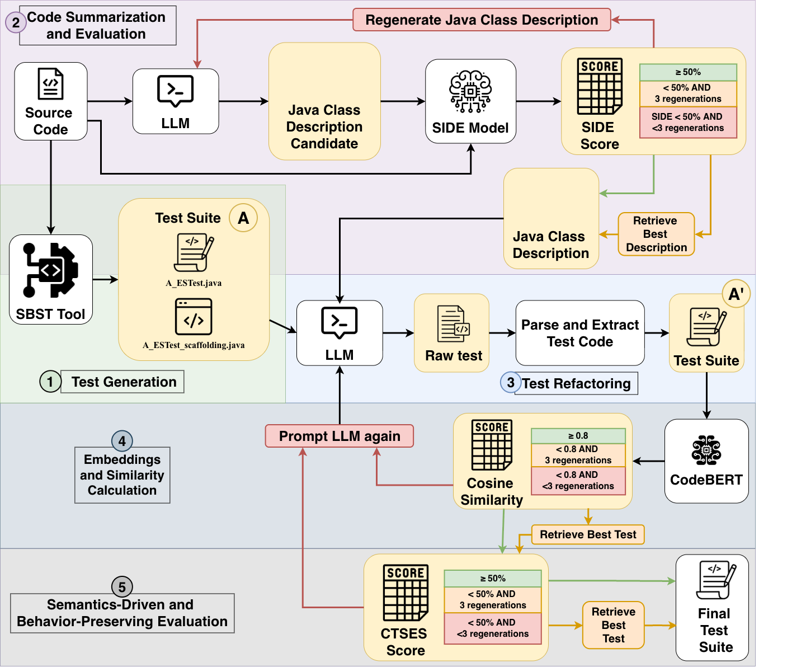

# TestHumanizer – Replication Package

**Humanizing Automatically Generated Unit Test Suites with LLM-Based Refactoring**

This repository contains the datasets, tool implementation, prompts, experimental artifacts, and results used in our study of **LLM-based refactoring of automatically generated Java unit tests**.

TestHumanizer investigates how Large Language Models (LLMs) can improve the readability, maintainability, and developer-oriented clarity of **EvoSuite-generated unit test suites**, while preserving compilability, semantic intent, and structural coverage.

<p align="center">
  
</p>

---

## What’s inside

### Main idea

Search-Based Software Testing (SBST) tools such as EvoSuite can generate compilable and high-coverage unit test suites at scale. However, these generated tests are often difficult to read, understand, maintain, and adopt in practice.

LLMs can generate more natural-looking tests, but direct one-shot generation is often brittle: generated tests may fail to compile, hallucinate APIs, or lose coverage.

**TestHumanizer** combines both strengths:

- EvoSuite provides behaviorally grounded test suites.
- LLMs act as controlled refactoring layers.
- Validation and similarity checks are used to preserve behavior.
- The resulting tests aim to be more readable, maintainable, and developer-friendly.

---

## Approach overview

TestHumanizer is organized as a validation-gated SBST+LLM pipeline.

The workflow includes five main phases:

1. **Test Generation**  
   EvoSuite generates JUnit test suites for Java classes under test.

2. **Code Summarization and Evaluation**  
   For the summary-based configuration, an LLM generates a natural-language class summary. The summary is evaluated with the SIDE model and regenerated when needed.

3. **Test Refactoring**  
   An LLM refactors the EvoSuite test suite under one of three context configurations:
   - **tests-only**
   - **code-centric**
   - **summary-based**

4. **Embeddings and Similarity Calculation**  
   Refactored tests are compared against the original EvoSuite tests using embedding-based similarity, including CodeBERT-based semantic comparison.

5. **Semantics-Driven and Behavior-Preserving Evaluation**  
   Candidate refactorings are filtered and selected using CTSES, compilation checks, validation results, and similarity-based safeguards.

---

## Research questions

This repository supports the experiments for six research questions.

- **RQ1 - Feasibility and compilability:**  
  How feasible and effective is TestHumanizer in producing syntactically correct and compilable refactored unit test suites?

- **RQ2 - Readability and understandability:**  
  To what extent does TestHumanizer improve the readability and understandability of EvoSuite-generated test suites?

- **RQ3 - Semantic and functional preservation:**  
  To what extent do TestHumanizer refactorings preserve the semantic behavior of the original EvoSuite tests?

- **RQ4 - Coverage impact:**  
  How does TestHumanizer impact the code coverage of the original EvoSuite-generated tests?

- **RQ5 - Test smell reduction:**  
  Does LLM-based refactoring reduce test smells in EvoSuite-generated test suites?

- **RQ6 - Human perception and practical usability:**  
  How do developers perceive TestHumanizer-refactored tests compared to original EvoSuite tests?

---

## Repository structure

```text
.
├── Approache/
│   ├── start_env_basic.sh
│   └── TestHumanizer/
│
├── Datasets/
│   ├── combined_base_extracted.json
│   ├── Defects4J_base_extracted.json
│   └── SF110_base_extracted.json
│
├── Dependancies/
│   ├── DEFECTS4J.zip
│   ├── JARS.zip
│   └── SF-110.zip
│
├── Generated_tests_EvoSuite/
│   ├── Defects4J_complet_enriched.json
│   └── SF110_complet_enriched.json
│
├── Prompts/
│   ├── code_centric.txt
│   ├── raw_generation.txt
│   ├── source_code_summarization.txt
│   ├── summary_based.txt
│   └── tests_only.txt
│
├── Refactored_data/
│   ├── Compilable_refactorings/
│   └── Raw_refactorings/
│
├── Results/
│   ├── RQ1/
│   ├── RQ2/
│   ├── RQ3/
│   ├── RQ4/
│   ├── RQ5/
│   └── RQ6/
│
├── SIDE_Model/
├── Summary_generated/
├── Zenodo/
│   └── README_ZENODO.md
│
├── TestHumanizer-Overview.png
└── reorganize_old_rq1_refactoring_artifacts.sh
```

---

## Main tool

The autonomous TestHumanizer tool is located in:

```text
Approache/TestHumanizer/
```

This directory contains the current executable Python package:

```text
Approache/TestHumanizer/
├── configs/
├── docs/
├── examples/
├── outputs/
├── scripts/
├── testhumanizer/
├── tests/
├── tools/
├── pyproject.toml
└── activate
```

The main command-line interface supports:

- target loading and indexing;
- EvoSuite test generation;
- original test validation;
- LLM input preparation;
- source-code summarization;
- prompt preparation;
- LLM-based refactoring;
- Java extraction and reconstruction;
- refactored test validation;
- CTSES computation;
- embedding similarity computation;
- readability, cognitive complexity, and PMD analyses;
- candidate selection;
- synthetic report generation.

For tool-specific documentation, see:

```text
Approache/TestHumanizer/README.md
Approache/TestHumanizer/docs/
```

---

## Datasets

The `Datasets/` directory contains the extracted metadata used to define the target classes:

```text
Datasets/
├── combined_base_extracted.json
├── Defects4J_base_extracted.json
└── SF110_base_extracted.json
```

These files describe the Java classes used in the study, including:

- dataset name;
- project name;
- bug identifier when available;
- class name;
- fully qualified package name;
- source code;
- token count;
- method count;
- LOC statistics.

The current dataset runner deduplicates targets using:

```text
dataset + project_name + bug-id + class + fqdn
```

---

## Large artifacts on Zenodo

Some artifacts are too large to be stored directly in GitHub. They are archived on Zenodo.

**Zenodo record:** https://zenodo.org/records/20644344  
**All-versions DOI:** https://doi.org/10.5281/zenodo.20644343

The Zenodo archive contains the large artifacts required for full replication and inspection:

```text
Refactored_data/
SIDE_Model/
Summary_generated/
Dependancies/
```

### Refactored_data

Contains raw and compilable LLM-refactored test suites.

```text
Refactored_data/
├── Raw_refactorings/
└── Compilable_refactorings/
```

The JSONL files contain full refactored test-suite contents.  
The CSV files contain flat metadata for indexing, filtering, and analysis.

### Dependancies

Contains compiled benchmark source layouts and Java dependencies:

```text
Dependancies/
├── DEFECTS4J.zip
├── JARS.zip
└── SF-110.zip
```

These archives are required by EvoSuite, compilation, validation, and coverage phases.

### SIDE_Model

Contains the SIDE model artifact used to evaluate source-code summaries.

### Summary_generated

Contains generated source-code summaries and mapping reports used by the summary-based configuration.

More details are available in:

```text
Zenodo/README_ZENODO.md
```

---

## EvoSuite-generated test metadata

The `Generated_tests_EvoSuite/` directory contains enriched metadata related to EvoSuite-generated suites:

```text
Generated_tests_EvoSuite/
├── Defects4J_complet_enriched.json
└── SF110_complet_enriched.json
```

These files include generated-test information and contextual metadata used during the refactoring pipeline.

---

## Prompts

The `Prompts/` directory contains the raw prompt templates used in the study:

```text
Prompts/
├── code_centric.txt
├── raw_generation.txt
├── source_code_summarization.txt
├── summary_based.txt
└── tests_only.txt
```

The prompts cover:

- direct LLM test generation;
- source-code summarization;
- tests-only refactoring;
- code-centric refactoring;
- summary-based refactoring.

---

## Experimental results

The `Results/` directory contains processed results organized by research question.

```text
Results/
├── RQ1/
├── RQ2/
├── RQ3/
├── RQ4/
├── RQ5/
└── RQ6/
```

### RQ1 : Feasibility and compilability

Contains compilation statistics, error categories, completeness checks, and SIDE summary statistics.

### RQ2 : Readability, complexity, and maintainability

Contains readability scores, cognitive complexity, cyclomatic complexity, maintainability analyses, summary statistics, and plotting scripts.

### RQ3 : Semantic and functional preservation

Contains CodeBERT, GraphCodeBERT, OpenAI embedding similarities, CTSES-related metrics, and aggregated similarity statistics.

### RQ4 : Coverage preservation

Contains JaCoCo instruction, line, and method coverage statistics, figures, and summary CSV files.

### RQ5 : Test smells

Contains smell prevalence, total smell counts, and unique smell statistics across scenarios.

### RQ6 : Human evaluation

Contains the human-evaluation artifacts, selected tasks, anonymized survey answers, annotation scores, inter-annotator agreement results, Wilcoxon tests, role-based summaries, and visualization outputs.

---

````markdown
## Quickstart

The main tool is located under:

```bash
cd Approache/TestHumanizer
````

Install the package in editable mode:

```bash
pip install -e .
```

Inspect the CLI:

```bash
testhumanizer --help
testhumanizer run --help
```

You can also inspect the active configuration before launching a run:

```bash
testhumanizer inspect-config \
  --config configs/experiments/evosuite_simple_project.yaml
```

---

## Running TestHumanizer on the bundled example project

Before running the full Defects4J or SF110 datasets, we recommend starting with the small bundled Java example project. This is the fastest way to verify that the tool, EvoSuite, validation, LLM calls, extraction, metrics, and reporting are correctly configured.

The example project is located under:

```text
Approache/TestHumanizer/examples/simple-java-project/
```

The default example configuration is:

```text
Approache/TestHumanizer/configs/experiments/evosuite_simple_project.yaml
```

### Minimal example run

From `Approache/TestHumanizer/`, run:

```bash
testhumanizer run \
  --config configs/experiments/evosuite_simple_project.yaml \
  --preset fast \
  --models gpt4o \
  --scenarios tests-only \
  --iterations 1
```

This command runs the full TestHumanizer workflow on the bundled example classes using:

* EvoSuite test generation;
* original test validation;
* source-code summarization;
* tests-only LLM refactoring;
* refactored test extraction;
* refactored test validation;
* CTSES and embedding-based similarity;
* readability, complexity, and maintainability metrics;
* candidate selection;
* synthetic report generation.

### Run without LLM calls

To test only the deterministic parts of the pipeline without calling the LLM provider:

```bash
testhumanizer run \
  --config configs/experiments/evosuite_simple_project.yaml \
  --preset fast \
  --no-llm
```

This is useful for checking installation, target loading, EvoSuite generation, validation, and local metric dependencies.

### Run without coverage

Coverage computation can be slower or require additional JaCoCo configuration. To disable coverage:

```bash
testhumanizer run \
  --config configs/experiments/evosuite_simple_project.yaml \
  --preset fast \
  --models gpt4o \
  --scenarios tests-only \
  --iterations 1 \
  --no-coverage
```

### Try multiple scenarios

TestHumanizer supports three refactoring scenarios:

* `tests-only`: refactor using only the EvoSuite-generated test suite;
* `code-centric`: refactor using the generated test suite and the full source code of the class under test;
* `summary-based`: refactor using the generated test suite and an LLM-generated class summary.

Run all scenarios with:

```bash
testhumanizer run \
  --config configs/experiments/evosuite_simple_project.yaml \
  --preset fast \
  --models gpt4o \
  --scenarios all \
  --iterations 1
```

Or run selected scenarios:

```bash
testhumanizer run \
  --config configs/experiments/evosuite_simple_project.yaml \
  --preset fast \
  --models gpt4o \
  --scenarios tests-only,summary-based \
  --iterations 1
```

### Try multiple models

If the required API keys are configured, multiple models can be evaluated in the same run:

```bash
testhumanizer run \
  --config configs/experiments/evosuite_simple_project.yaml \
  --preset fast \
  --models gpt4o,mistral \
  --scenarios tests-only \
  --iterations 1
```

### Increase logging details

For a more verbose execution trace:

```bash
testhumanizer run \
  --config configs/experiments/evosuite_simple_project.yaml \
  --preset fast \
  --models gpt4o \
  --scenarios tests-only \
  --iterations 1 \
  --log-level verbose \
  --show-details \
  --show-metrics
```

### Expected example outputs

By default, outputs are written under the output directory configured in the YAML file. A typical run produces:

```text
outputs/
├── 01_targets/
├── 02_evosuite/
├── 03_inputs/
├── 04_prompts/
├── 05_validation/
├── 06_metrics/
└── 07_reports/
```

The final synthetic report and dashboard are available under:

```text
outputs/.../07_reports/
```

The most useful files to inspect after a successful run are:

```text
07_reports/report_summary.json
07_reports/report.md
07_reports/figures/
06_metrics/selection/selected_candidates.csv
02_evosuite/original_suites_metadata.csv
05_validation/original_compilation_results.csv
```

---

## Running TestHumanizer on Defects4J and SF110

After validating the bundled example project, you can run TestHumanizer on the extracted Defects4J and SF110 metadata using the dataset experiment runner:

```text
Approache/TestHumanizer/scripts/run_dataset_experiment.py
```

The dataset runner reads the JSON metadata, deduplicates target classes, resolves `.java` and `.class` files, generates a TestHumanizer-compatible target CSV, creates a run-specific YAML configuration, and optionally launches the full pipeline.

See the dataset reproduction commands below for Defects4J and SF110.

```
```
---

## Reproducing a small Defects4J sample

```bash
cd Approache/TestHumanizer

python scripts/run_dataset_experiment.py \
  --dataset defects4j \
  --metadata ../../Datasets/Defects4J_base_extracted.json \
  --base-config configs/templates/base_dataset_experiment.yaml \
  --output-root outputs/reproducibility \
  --sample-size 2 \
  --sample-seed 42 \
  --models gpt4o \
  --scenarios tests-only \
  --iterations 1 \
  --preset fast
```

Expected outputs:

```text
outputs/reproducibility/defects4j/sample_2_seed_42/
├── generated_targets.csv
├── target_diagnostics.csv
├── selected_targets.json
├── all_valid_targets.json
├── skipped_missing_files.json
├── dataset_summary.json
├── generated_config.yaml
├── run_command.txt
└── testhumanizer_outputs/
```

The final report is generated under:

```text
outputs/reproducibility/defects4j/sample_2_seed_42/testhumanizer_outputs/07_reports/
```

---

## Reproducing a small SF110 sample

```bash
cd Approache/TestHumanizer

python scripts/run_dataset_experiment.py \
  --dataset sf110 \
  --metadata ../../Datasets/SF110_base_extracted.json \
  --base-config configs/templates/base_dataset_experiment.yaml \
  --output-root outputs/reproducibility \
  --sample-size 2 \
  --sample-seed 42 \
  --models gpt4o \
  --scenarios tests-only \
  --iterations 1 \
  --preset fast
```

Expected outputs:

```text
outputs/reproducibility/sf110/sample_2_seed_42/
├── generated_targets.csv
├── target_diagnostics.csv
├── selected_targets.json
├── all_valid_targets.json
├── skipped_missing_files.json
├── dataset_summary.json
├── generated_config.yaml
├── run_command.txt
└── testhumanizer_outputs/
```

---

## Full reproduction

To run all valid Defects4J targets:

```bash
cd Approache/TestHumanizer

python scripts/run_dataset_experiment.py \
  --dataset defects4j \
  --metadata ../../Datasets/Defects4J_base_extracted.json \
  --base-config configs/templates/base_dataset_experiment.yaml \
  --output-root outputs/reproducibility \
  --full \
  --models gpt4o \
  --scenarios tests-only \
  --iterations 1 \
  --preset fast
```

To run all valid SF110 targets:

```bash
cd Approache/TestHumanizer

python scripts/run_dataset_experiment.py \
  --dataset sf110 \
  --metadata ../../Datasets/SF110_base_extracted.json \
  --base-config configs/templates/base_dataset_experiment.yaml \
  --output-root outputs/reproducibility \
  --full \
  --models gpt4o \
  --scenarios tests-only \
  --iterations 1 \
  --preset fast
```

For full paper-like experiments with all scenarios and multiple iterations:

```bash
cd Approache/TestHumanizer

python scripts/run_dataset_experiment.py \
  --dataset defects4j \
  --metadata ../../Datasets/Defects4J_base_extracted.json \
  --base-config configs/templates/base_dataset_experiment.yaml \
  --output-root outputs/reproducibility \
  --full \
  --models gpt4o,mistral \
  --scenarios all \
  --iterations 3 \
  --preset full
```

---

## Reproducibility notes

- The GitHub repository contains the executable code, scripts, configurations, documentation, prompts, metadata, and result summaries.
- The Zenodo archive contains large artifacts required for full replication.
- The dataset runner automatically generates target CSV files and run-specific YAML configurations.
- Global dependency directories are not injected into EvoSuite by default, because unrelated jars may cause EvoSuite bytecode analysis failures.
- If a target project needs additional dependencies, use `--extra-classpath` with explicit jar paths.

Example:

```bash
python scripts/run_dataset_experiment.py \
  --dataset defects4j \
  --metadata ../../Datasets/Defects4J_base_extracted.json \
  --base-config configs/templates/base_dataset_experiment.yaml \
  --output-root outputs/reproducibility \
  --sample-size 2 \
  --extra-classpath "/path/to/dependency.jar"
```

---
